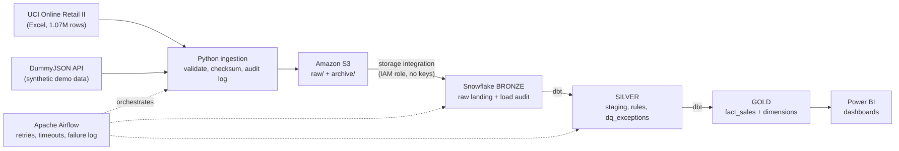
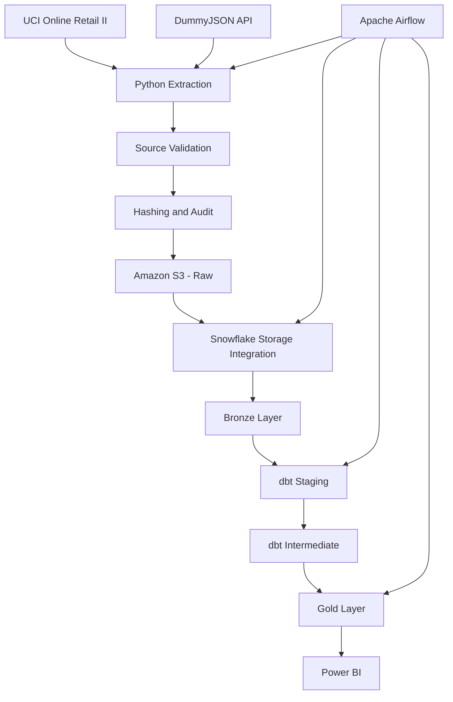

# Retail Sales Data Engineering Platform

<<<<<<< HEAD
An end-to-end, repeatable data platform for retail sales analytics: **Python → Amazon S3 → Snowflake (Bronze / Silver / Gold) → dbt → Apache Airflow → Power BI**, with data-quality rules, audit logging, idempotent loads and a tested failure/recovery drill.



> **Data disclaimer.** The primary data is the public UCI *Online Retail II* dataset (a UK online giftware retailer, Dec 2009 to Dec 2011). A synthetic DummyJSON API is used only to practise API ingestion. **This is not Tesco data and not a live retailer integration.**

## What it does
- Ingests 1,067,371 historical invoice lines (53,628 invoices, 5,942 customers) and three demo API sources.
- Lands raw files in S3 with row counts, SHA-256 checksums and an audit log; unchanged files are skipped.
- Loads Snowflake Bronze through a **storage integration (IAM role, no AWS keys in code)** with a load-audit table.
- Applies documented business rules in dbt (cancellations, stock write-offs, zero prices, non-product codes, duplicates, unknown customers) to produce a tested star schema.
- Orchestrates the daily run in Airflow with retries, timeouts and a failure log.
- Serves a Power BI dashboard from the Gold layer.

## Stack
Python (requests, pandas, boto3) · Amazon S3 + IAM · Snowflake · dbt-snowflake · Apache Airflow 3 · Power BI Desktop · GitHub

## Data quality at a glance (from profiling the source)
| Finding | Rows | Handling |
|---|---|---|
| Exact duplicate rows | 34,335 (3.2%) | Flagged with a row hash; removed in Silver behind a switch (`dedupe_exact_rows`) |
| Cancellation (`C`) invoice rows | 19,494 | Kept; reported as returns, never silently netted |
| Non-cancellation rows with quantity <= 0 | 3,457 | Stock write-offs (damaged, missing...): excluded from revenue |
| Missing customer ID | 243,007 (22.8%) | Kept in sales totals, excluded from customer metrics |
| Non-product stock codes | 63 codes | Classified (postage, fees, discounts, vouchers...) and reported separately |
| Cancellation with positive quantity | 1 | Quarantined in `dq_exceptions` |

Full rules: [docs/business_rules.md](docs/business_rules.md) · Evidence: [failure drill](docs/failure_recovery_evidence.md), [reconciliation](docs/reconciliation.md), [data quality and recovery](docs/data_quality.md).

## Dashboard
Built in Power BI on the Gold layer (Import mode). Setup and DAX: [docs/powerbi_guide.md](docs/powerbi_guide.md), [powerbi/measures.dax](powerbi/measures.dax).

| Overview | Products |
|---|---|
|  |  |
| **Customers** | **Returns and cancellations** |
|  |  |

Source limitations are listed on the dashboard's data-notes page and in [docs/source_limitations.md](docs/source_limitations.md).

## Repository layout
```
dags/            Airflow DAG (retail_pipeline)
ingestion/       Extract, validate, upload to S3, load Snowflake, reconcile
src/             Shared config
sql/             Snowflake setup, stage, Bronze tables and load
dbt/retail_analytics/   Staging, intermediate and Gold models, seeds, tests
powerbi/         DAX measures
scripts/         start_airflow.sh, failure_drill.py
docs/            Architecture, data dictionary, rules, guides, evidence
tests/           Python tests
```

## Setup (summary)
Detailed guides: [AWS](docs/aws_setup.md) · [Snowflake](docs/snowflake_setup.md) · [dbt](docs/dbt_setup.md) · [Airflow](docs/airflow_setup.md) · [Power BI](docs/powerbi_guide.md)

1. `python3 -m venv ~/.venvs/retail && source ~/.venvs/retail/bin/activate && pip install -r requirements.txt snowflake-connector-python dbt-snowflake`
2. Download `online_retail_II.xlsx` from the [UCI page](https://archive.ics.uci.edu/dataset/502/online+retail+ii) into `data/raw/`.
3. Copy `.env.example` to `.env`; set `S3_BUCKET` and `AWS_PROFILE`. Keep Snowflake credentials in environment variables, never in files in the repo.
4. Create the S3 bucket and least-privilege IAM user ([docs/aws_setup.md](docs/aws_setup.md)); run `python -m ingestion.fetch_dummyjson` then `python -m ingestion.upload_to_s3`.
5. Run the Snowflake scripts in `sql/` in order, then `dbt seed && dbt build` in `dbt/retail_analytics`.
6. Start Airflow with `./scripts/start_airflow.sh` and trigger `retail_pipeline`.

Run the tests: `pytest` and `python -m scripts.failure_drill`.

## Reliability design
- **Idempotent by layer:** upload skips unchanged files (deterministic gzip + per-source SHA-256); `COPY INTO` skips loaded files; Silver dedupes by row hash; Gold keys are unique and tested.
- **Fail fast:** `validate_extracts` stops the run before anything is uploaded; `COPY ... ON_ERROR = ABORT_STATEMENT` never leaves a partial file in Bronze.
- **Recovery:** clear the failed Airflow task and rerun; everything downstream is safe to repeat. Runbook in [docs/data_quality.md](docs/data_quality.md).
- **Cost and security:** XSMALL warehouse with 60 s auto-suspend and a 5-credit resource monitor; no secrets in Git; the fake sensitive fields in the API users data (password, ssn, bank...) are stripped before upload.

## Lessons learned
See [docs/troubleshooting.md](docs/troubleshooting.md) for the real problems hit and how they were fixed (a space in the project path breaking venv scripts, non-deterministic gzip hashes breaking idempotency, `.env` blanks overriding real credentials, a date table with gaps).

## Possible next steps
Incremental dbt models for larger volumes, Docker Compose / Kubernetes deployment, email or Slack alerts, CI with GitHub Actions.
=======
**End-to-end cloud data engineering platform using Python, Amazon S3,
Snowflake, dbt, Apache Airflow and Power BI.**

This project demonstrates a complete retail data pipeline: source
extraction, validation, cloud storage, warehouse loading,
transformation, data-quality management, orchestration and business
intelligence.

## 1. Project Overview

The platform transforms historical retail transactions and supplementary
API data into analytics-ready datasets.

Python extracts and validates data, Amazon S3 stores raw files,
Snowflake provides the warehouse, dbt manages transformations and tests,
and Apache Airflow orchestrates pipeline execution. Power BI consumes
curated Gold-layer datasets.

### Objectives

-   Build an end-to-end ETL/ELT pipeline.
-   Ingest historical retail data and supplementary API data.
-   Store raw data in Amazon S3.
-   Load data into Snowflake using secure storage integration.
-   Implement Bronze, Silver and Gold data layers.
-   Apply business rules and data-quality checks with dbt.
-   Orchestrate workflows using Apache Airflow.
-   Implement audit logging, file validation and idempotent processing.
-   Deliver analytics-ready datasets for Power BI.
-   Document failure handling and recovery procedures.

## 2. Solution Architecture



  Technology       Responsibility
  ---------------- ---------------------------------------
  Python           Extraction, validation and ingestion
  Amazon S3        Raw data storage
  AWS IAM          Secure access permissions
  Snowflake        Cloud data warehouse
  dbt              Transformation, modelling and testing
  Apache Airflow   Workflow orchestration
  Docker           Local orchestration environment
  Power BI         Business intelligence and reporting
  Git and GitHub   Version control

## 3. Data Sources

### UCI Online Retail II

Primary source: [UCI Online Retail
II](https://archive.ics.uci.edu/dataset/502/online+retail+ii)

The dataset contains historical transactions from a UK-based online
giftware retailer between December 2009 and December 2011.

**Reported source profile**

  Metric                                         Value
  ------------------- --------------------------------
  Transaction lines                          1,067,371
  Invoices                                      53,628
  Customers                                      5,942
  Historical period     December 2009 -- December 2011

### DummyJSON API

Supplementary synthetic API sources:

-   [Products](https://dummyjson.com/products?limit=0)
-   [Carts](https://dummyjson.com/carts?limit=0)
-   [Users](https://dummyjson.com/users?limit=0)
-   [API documentation](https://dummyjson.com/docs)

> **Source limitation:** DummyJSON is synthetic demonstration data. It
> is not part of the UCI transaction dataset and does not represent a
> live retailer integration. This project does not claim access to Tesco
> or any other retailer's private systems.

## 4. Pipeline Components

### Python extraction and validation

-   Reads and profiles the historical Excel dataset.
-   Extracts product, cart and user data from API endpoints.
-   Validates source availability and expected structures.
-   Records source metadata and processing information.

### Amazon S3 data lake

-   Structured raw-data storage.
-   SHA-256 checksums.
-   Row-count metadata and audit logging.
-   Deterministic gzip compression.
-   Hash-based change detection to skip unchanged files.

### Snowflake data warehouse

AWS IAM and Snowflake storage integration provide access between S3 and
Snowflake without embedding AWS access keys in application code.

-   **Bronze:** ingested source records, source metadata and load audit
    information.
-   **Silver:** standardised data, duplicate handling, business rules
    and data-quality exceptions.
-   **Gold:** curated analytical models for sales, products, customers
    and returns.

### dbt transformation

-   Staging models for source standardisation.
-   Intermediate models for business logic.
-   Gold models for analytical consumption.
-   Schema and data-quality tests.
-   Model documentation and lineage.

### Apache Airflow orchestration

The `retail_pipeline` DAG coordinates ingestion, validation, S3 upload,
Snowflake loading, transformations and downstream verification.

Reliability features include task dependencies, retries, timeouts,
execution logging, failure handling and controlled reruns.

### Power BI

Power BI consumes curated Snowflake Gold datasets using Import mode.
Reporting covers sales performance, product performance, customer
analysis, returns, revenue trends and business KPIs.

## 5. Data Quality and Business Rules

Source profiling identified the following characteristics.

  ------------------------------------------------------------------------
  Finding                           Reported records Treatment
  --------------------- ---------------------------- ---------------------
  Exact duplicate rows                        34,335 Flagged using row
                                                     hashes; configurable
                                                     deduplication in
                                                     Silver

  Cancellation invoice                        19,494 Retained and
  rows                                               classified as returns

  Non-cancellation rows                        3,457 Classified as stock
  with quantity ≤ 0                                  write-offs and
                                                     excluded from revenue

  Missing customer IDs                       243,007 Retained in sales
                                                     totals but excluded
                                                     from
                                                     customer-specific
                                                     metrics

  Non-product stock                         63 codes Classified separately
  codes                                              from product sales

  Cancellation with                      1 exception Quarantined for
  positive quantity                                  investigation
  ------------------------------------------------------------------------

These are reported profiling results and should be interpreted alongside
the documented business rules and reconciliation checks.

The platform distinguishes product sales, customer activity,
cancellations and returns, stock write-offs, postage and service
charges, discounts and vouchers, missing customer information, and
duplicate source records.

A configurable `dedupe_exact_rows` switch controls exact-row
deduplication.

Supporting documentation:

-   `docs/business_rules.md`
-   `docs/data_quality.md`
-   `docs/reconciliation.md`
-   `docs/source_limitations.md`

## 6. Reliability, Idempotency and Recovery

### Idempotent ingestion

Deterministic compression and SHA-256 checksums identify unchanged
source files and help avoid unnecessary uploads. Snowflake load history
is used to prevent previously loaded files from being loaded again.

### Validation and loading

Source validation takes place before upload. Invalid extracts fail
validation rather than silently continuing.

Snowflake loading uses:

``` sql
ON_ERROR = ABORT_STATEMENT
```

This prevents a partially loaded file from being treated as a successful
ingestion.

### Failure handling

-   Airflow retries and timeouts.
-   Execution and failure logging.
-   Load-audit tracking.
-   Data-quality exception handling.
-   Documented recovery procedures.
-   Safe rerun design.

See `docs/failure_recovery_evidence.md` and `docs/reconciliation.md`.

## 7. Repository Structure

``` text
retail-sales-data-engineering/
├── dags/
│   └── retail_pipeline.py
├── ingestion/
│   ├── extract/
│   ├── validate/
│   ├── upload/
│   ├── load/
│   └── reconciliation/
├── src/
├── sql/
│   ├── snowflake_setup/
│   ├── stages/
│   ├── bronze/
│   └── loading/
├── dbt/
│   └── retail_analytics/
│       ├── models/
│       │   ├── staging/
│       │   ├── intermediate/
│       │   └── marts/
│       ├── seeds/
│       ├── tests/
│       └── dbt_project.yml
├── powerbi/
│   └── measures.dax
├── scripts/
│   ├── start_airflow.sh
│   └── failure_drill.py
├── docs/
├── tests/
├── .env.example
├── .gitignore
├── requirements.txt
└── README.md
```

*This is a logical overview. Adjust the tree to match the actual
repository files and directories.*

## 8. Setup and Execution

### Prerequisites

-   Python 3.12
-   Git
-   Docker and Docker Compose
-   AWS account, S3 bucket and configured IAM permissions
-   Snowflake account and warehouse
-   dbt with the Snowflake adapter
-   Power BI Desktop

### 1. Clone the repository

``` bash
git clone https://github.com/muhammadwaqas156/retail-sales-data-engineering.git
cd retail-sales-data-engineering
```

### 2. Create a Python environment

``` bash
python -m venv .venv
```

Activate on Windows PowerShell:

``` powershell
.\.venv\Scripts\Activate.ps1
```

Install dependencies:

``` bash
python -m pip install --upgrade pip
pip install -r requirements.txt
```

### 3. Configure environment variables

Create a local `.env` file using `.env.example` as a template. Configure
the required AWS, S3 and Snowflake settings.

**Never commit `.env`, passwords, private keys or cloud credentials to
GitHub.**

### 4. Prepare the source data

Download the [UCI Online Retail II
dataset](https://archive.ics.uci.edu/dataset/502/online+retail+ii) and
place the workbook in the configured raw-data directory. Run the
project's extraction and validation scripts according to the ingestion
instructions.

### 5. Configure AWS and Snowflake

-   Configure the S3 bucket.
-   Configure the required IAM role and permissions.
-   Create the Snowflake storage integration.
-   Configure the external stage.
-   Create the required database, schemas and Bronze tables.
-   Verify Snowflake access to the S3 source location.

Refer to the AWS and Snowflake setup documentation in `docs/`.

### 6. Run dbt

``` bash
cd dbt/retail_analytics
dbt debug
dbt build
```

### 7. Start Airflow

Return to the repository root and follow the documented startup
procedure:

``` bash
./scripts/start_airflow.sh
```

Open the Airflow web interface, locate the `retail_pipeline` DAG,
trigger the pipeline and inspect the task logs.

### 8. Validate outputs

Verify S3 source files and metadata, Snowflake Bronze load history,
Silver data-quality results, Gold model outputs, dbt test results,
Airflow task status and Power BI reporting figures.

Use `docs/reconciliation.md` for cross-layer validation guidance.

## 9. Testing and Validation

  Validation area     Purpose
  ------------------- -------------------------------------------
  Source validation   Check source files and structure
  File integrity      Verify SHA-256 checksums
  S3 ingestion        Confirm uploaded files and metadata
  Snowflake loading   Verify load history and audit status
  dbt tests           Validate transformed models
  Data quality        Identify invalid and exceptional records
  Reconciliation      Compare counts and metrics between layers
  Airflow             Verify task execution and recovery

Run Python tests using the repository's test configuration.

The project also includes a failure-drill script:

``` bash
python -m scripts.failure_drill
```

## 10. Cost and Security

### Cost controls

-   Snowflake X-Small warehouse configuration.
-   60-second warehouse auto-suspend.
-   Five-credit resource monitor.
-   Avoid unnecessary warehouse execution.
-   Stop unused local services and containers.

### Security controls

-   AWS IAM role-based access.
-   Snowflake storage integration.
-   No hardcoded AWS access keys in application code.
-   Environment-based credential configuration.
-   `.gitignore` protection for sensitive files.
-   Removal of unnecessary sensitive DummyJSON user fields before
    upload.

## 11. Documentation and Evidence

  Document                         Purpose
  -------------------------------- -------------------------------------
  `business_rules.md`              Retail business logic
  `data_quality.md`                Data-quality findings and treatment
  `reconciliation.md`              Cross-layer validation
  `failure_recovery_evidence.md`   Failure and recovery scenarios
  `powerbi_guide.md`               Dashboard guidance
  `source_limitations.md`          Dataset limitations

Power BI screenshots and execution evidence are maintained in the
repository.

## 12. Engineering Challenges and Solutions

**Non-deterministic file compression**\
Different compressed outputs could produce different hashes even when
the source data had not changed. Deterministic gzip settings and
source-level SHA-256 checksums improve repeatable file identification.

**Duplicate retail transactions**\
Exact duplicate records are identified through row hashing and handled
through configurable deduplication in Silver.

**Missing customer identifiers**\
Transactions without customer IDs remain in sales reporting but are
excluded from customer-specific metrics.

**Returns and cancellations**\
Cancellation records are classified separately rather than treated as
ordinary positive sales.

**API data sensitivity**\
Unnecessary sensitive fields from synthetic user API responses are
removed before cloud upload.

**Pipeline recovery**\
Ingestion audit records, load history, idempotent processing and
documented recovery procedures support controlled reruns.

## 13. Future Improvements

-   Incremental dbt models for larger data volumes.
-   GitHub Actions for automated CI/CD.
-   Automated pipeline notifications through email or Slack.
-   Expanded monitoring and observability.
-   Additional analytical dimensions.
-   Further Snowflake performance optimisation.
-   Production cloud deployment of orchestration services.

## 14. Project Outcome

This project demonstrates a modern data engineering workflow from raw
data extraction to business intelligence reporting. It brings together
cloud storage, secure data access, warehouse architecture,
transformation engineering, data-quality management, workflow
orchestration, operational recovery and analytical consumption.

------------------------------------------------------------------------

## Author

**Muhammad Waqas**\
MSc Advanced Computer Science \| Data Engineering \| Analytics

-   **GitHub:** [muhammadwaqas156](https://github.com/muhammadwaqas156)
-   **LinkedIn:** [Muhammad
    Waqas](https://linkedin.com/in/muhammadwaqas2798156)
-   **Project repository:**
    [retail-sales-data-engineering](https://github.com/muhammadwaqas156/retail-sales-data-engineering)
>>>>>>> c6c696e (docs: enhance retail data engineering project documentation)
